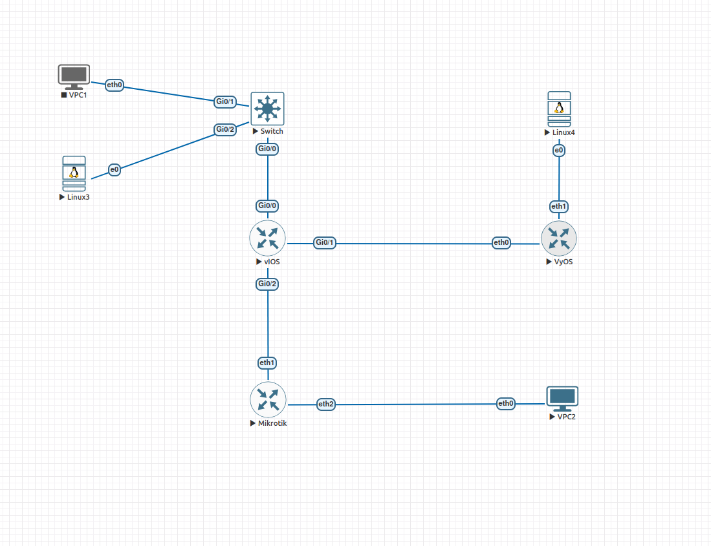

# Chapitre 01 — Analyse du trafic réseau

Analyse des échanges réseau du laboratoire fictif **CamTrust Bank**,
réalisée dans le cadre du parcours ECNSA de l’Académie ENIX.

Ce projet porte sur l’observation des protocoles, l’identification
des informations exposées et la proposition de mesures de sécurisation.

## Fiche du projet

| Élément | Description |
|---|---|
| Parcours | ENIX Certified Network Security Associate — ECNSA |
| Sujet | Analyse du trafic et exposition des informations |
| Date des tests | 24 octobre 2026 |
| Environnement | Laboratoire virtualisé dans EVE-NG |
| Auteur | Grinnel |
| Encadrement | M. MOUNIR NJI Amine |
| Statut | Termine |

## Objectifs

- Observer les échanges entre les équipements du laboratoire.
- Comprendre la résolution ARP et l’attribution de configuration par DHCP.
- Identifier la passerelle et les correspondances entre adresses IP et MAC.
- Examiner les requêtes et réponses DNS.
- Rechercher les informations exposées par HTTP, FTP, Telnet et SNMP v2c.
- Constituer des preuves à partir des captures réseau.
- Proposer un plan d’action pour sécuriser les services étudiés.

## Périmètre

Le laboratoire reproduit le siège de Yaoundé, une agence à Douala
et un accès Internet simulé.



| Zone | Réseau / adresse | Équipements |
|---|---|---|
| Siège de Yaoundé | `10.10.10.0/24` | R-SIEGE, SW-SIEGE, CLIENT-LINUX, PC-SIEGE |
| Agence de Douala | `10.20.10.0/24` | R-DLA, PC-DLA |
| Liaison privée simulée | `172.16.12.0/30` | R-SIEGE et R-DLA |
| Internet simulé | SRV-INTERNET : `203.0.113.10` | R-FAI, SRV-INTERNET |

Les tests sont limités aux équipements virtuels de ce laboratoire.
Aucun équipement ni réseau de production n’est inclus dans le périmètre.

## Environnement technique

| Outil / système | Rôle |
|---|---|
| VMware Workstation | Hébergement de la VM EVE-NG |
| EVE-NG | Exécution de la topologie ; VM dotée de 6 Go de RAM et 4 vCPU |
| Cisco IOSv / IOSvL2 | Routeur R-SIEGE et commutateur SW-SIEGE |
| MikroTik CHR | Routeur R-DLA |
| VyOS | Routeur R-FAI |
| Ubuntu Server 22.04 | SRV-INTERNET et CLIENT-LINUX |
| VPCS | PC-SIEGE et PC-DLA |
| Wireshark | Capture et analyse des échanges |
| curl, dig, snmpwalk, telnet | Génération des échanges de test |
| base64 | Décodage de la valeur d’authentification HTTP Basic |
| LaTeX | Rédaction du rapport |

Les configurations disponibles dans `configs/` complètent
la description de l’environnement.

## Organisation des fichiers

```text
chapitre-01/
├── README.md
├── rapport/
│   ├── rapport.tex
│   └── images/
│       ├── architecture.png
│       ├── http.png
│       ├── ftp.png
│       ├── telnet.png
│       ├── snmp.png
│       └── dns.png
├── livrables/
│   └── rapport.pdf
├── captures/
│   └── ...
├── configs/
│   ├── R-SIEGE/
│   ├── R-DLA/
│   └── R-FAI/
└── eve-ng/
    └── chapitre-01.zip
```

Les noms des fichiers de capture et les éléments de configuration
peuvent évoluer pendant la finalisation du projet.

## Démarche

1. Définir le périmètre et vérifier la connectivité du laboratoire.
2. Capturer le trafic aux points d’observation retenus.
3. Générer les échanges depuis les postes clients.
4. Filtrer les captures et examiner les champs utiles.
5. Associer les observations aux preuves correspondantes.
6. Rédiger les constats et proposer des remédiations.

L’analyse distingue :
- les informations directement visibles dans les captures ;
- les hypothèses nécessitant une vérification ;
- les recommandations, qui ne constituent pas des corrections
  déjà déployées.

## Analyses réalisées

### ARP

Observation des demandes et réponses ARP pour établir les
correspondances entre adresses IPv4 et adresses MAC.

L’identification de la MAC de la passerelle s’appuie sur :
1. la lecture de l’adresse du routeur proposée dans les offres DHCP ;
2. la recherche d’une réponse ARP associée à cette adresse.

### DHCP

Observation des étapes DORA :

- Discover ;
- Offer ;
- Request ;
- Acknowledge.

Examen des paramètres proposés au client, notamment l’adresse IP,
le masque et l’option `Router`.

### DNS

Observation des requêtes et des réponses DNS sur UDP 53,
ainsi que des identifiants de transaction.

### Services applicatifs et administration

| Service | Observation dans le laboratoire |
|---|---|
| HTTP | Valeur d’authentification Basic décodable, révélant l’identifiant et le mot de passe |
| FTP | Commandes `USER` et `PASS` visibles dans les échanges |
| Telnet | Identifiants et commandes d’administration lisibles dans le flux |
| SNMP v2c | Communauté `public` et informations système visibles |
| DNS | Requêtes et réponses consultables dans la capture |

Les captures et le rapport constituent les preuves de ces observations.

## Remédiations proposées

| Service | Action proposée |
|---|---|
| HTTP | Migrer vers HTTPS |
| FTP | Remplacer par SFTP ou FTPS |
| Telnet | Migrer vers SSH v2, puis interdire Telnet |
| SNMP v2c | Migrer vers SNMPv3 avec authentification et chiffrement |
| DNS | Étudier le chiffrement des échanges avec un résolveur approuvé |

Ces actions sont proposées à partir des constats du laboratoire.
Leur présence dans ce tableau ne signifie pas qu’elles ont été
mises en œuvre et validées.

Les détails et estimations d’effort figurent dans le rapport.

## Consulter les livrables

- [Rapport final](livrables/rapport.pdf)
- [Sources LaTeX](rapport/)
- [Captures réseau](captures/)
- [Configurations](configs/)
- [Export EVE-NG](eve-ng/)

Pour une lecture rapide, commencer par le résumé pour la direction,
puis consulter les constats, les preuves et le plan d’action.

## Reproduire le laboratoire

1. Disposer d’une installation EVE-NG et des images nécessaires.
2. Importer l’export du laboratoire présent dans `eve-ng/`.
3. Vérifier la correspondance entre les images disponibles
   et celles attendues par les nœuds.
4. Contrôler les configurations, l’adressage et les connexions.
5. Consulter le rapport pour reproduire les échanges de test.
6. Ouvrir les captures fournies avec Wireshark pour comparer les résultats.

Les images système des équipements ne sont pas distribuées dans ce dépôt.
L’export du lab ne remplace pas les vérifications de configuration
et de connectivité.

## Limites

- Les résultats concernent un environnement pédagogique contrôlé.
- Les estimations de remédiation ne sont pas des délais garantis
  de déploiement en entreprise.

## Participants et contributions

| Participant | Contributions |
|---|---|
| Grinnel | Mise en œuvre de la topologie réseau, configuration des équipements, génération et analyse approfondie des captures de paquets, et rédaction technique du livrable. |
| Etoundi | Assistance ponctuelle et support à la rédaction du rapport. |


## Confidentialité et usage responsable


Ce projet est un travail étudiant non officiel réalisé
dans le cadre pédagogique de l’Académie ENIX.